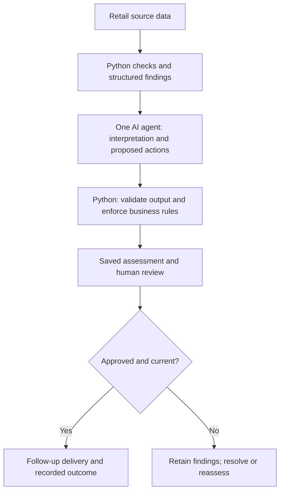

# Retail Campaign Readiness Agentic Workflow

**Before campaign traffic begins, are the products available, product pages ready, campaign tasks complete, and unresolved risks visible to the people responsible?**

This agentic workflow brings those checks into one reviewable process. It combines deterministic retail analysis with LLM model synthesis and inference, persists the assessment and its evidence, records human review, and delivers an approved follow-up task.

The implementation demonstrates architectural patterns used in operational AI systems: explicit business contracts, workflow state management, human approval gates, provider abstraction, and recoverable downstream execution.

A Streamlit interface makes the workflow inspectable through both successful and deliberately failing scenarios.

## Capabilities demonstrated

| Capability | Implementation | Evidence |
|---|---|---|
| **Workflow orchestration** | Explicit stages for source validation, domain analysis, model assessment, policy enforcement, review, and delivery | Shared Python services used by the CLI and Streamlit |
| **Durable workflow state** | SQLite stores assessments, source fingerprints, review decisions, queued deliveries, and delivery attempts | Persistence and restart tests in `tests/test_workflow.py` and `tests/test_delivery.py` |
| **Human approvals** | Review requires attribution and a reason; blocked, unavailable, or stale assessments cannot be approved | Approval-gate and competing-review tests |
| **Reliable downstream execution** | Persisted delivery intent, stable idempotency key, transactional local dispatch, and deduplicating receiver | Lost-response, interruption, and concurrent-worker tests |
| **Python development** | Modular application services, typed domain models, provider adapters, validators, and connectors | Implementation under `app/`; automated test suite |
| **API and JSON schema integration** | OpenAI Responses API requests structured output using a strict JSON Schema; application validation checks business conditions and evidence references | `app/llms/openai_client.py` and `tests/test_openai_client.py` |
| **Model provider independence** | `LLMClient` interface supports OpenAI, Anthropic, and mock implementations | Provider factory and separate adapters under `app/llms/` |
| **Framework-agnostic architecture** | Business rules and workflow state live in ordinary Python services, independently of an agent orchestration framework | Separate analyzer, policy, model, workflow, and delivery boundaries |
| **Execution traceability** | Saved findings, source evidence, original model response, enforced result, review decision, and delivery history | UI evidence and history views; persistence tests |
| **Inference provenance** | Saved assessments identify live or simulated mode, provider, and model; OpenAI responses also record response ID and token usage when available | Provider metadata and UI tests |

The repository implements a **local reference workflow**. Remote enterprise integrations, OAuth, webhooks, distributed workers, and production hosting remain additional implementation work.

Extend source adapters to retrieve versioned records from retail APIs, Google Workspace, Box, or DAM systems. Replace the local inbox with an authenticated enterprise task connector that preserves delivery idempotency. Validated source-change webhooks can trigger reassessment, while enterprise identity integration can control review and approval permissions.

## Business process

The workflow coordinates information needed by merchandising, inventory, campaign, and product-quality teams.

1. **Validate sources.** Reject malformed inputs before requesting model inference.
2. **Analyze operational conditions.** Identify stock shortages, catalog issues, incomplete campaign tasks, customer-feedback themes, and data-quality gaps.
3. **Run the AI assessment.** Ask one model to interpret the structured findings and propose evidence-linked actions.
4. **Enforce readiness policy.** Validate the response and preserve mandatory business constraints.
5. **Persist the assessment.** Save its findings, evidence, source fingerprint, model output, and enforced result.
6. **Record human review.** Associate the decision with the specific assessed snapshot.
7. **Deliver approved follow-up.** Queue a task, execute the handoff, and record the outcome.

**Approval acknowledges an assessment. It does not authorize a launch, clear findings, or change an At Risk assessment to Ready.**

## Architecture and model boundary



**The model supplies interpretation and proposed actions. Python enforces the rules and manages workflow state, approval gates, and delivery.**

### Where the AI fits

This is a **single-agent, AI-assisted workflow with deterministic checks**. One model reasons over structured operational findings, synthesizes risks across domains, and proposes evidence-linked follow-up actions.

For example, low inventory, an incomplete campaign task, and customer sizing feedback may each be understandable separately. The model can interpret their relationship and explain what the combination means for the campaign team.

Python establishes the findings, validates the model’s response, enforces mandatory readiness rules, and manages review and delivery. Those controls make model reasoning usable within an accountable business process.

The current agent performs a bounded assessment. It does not independently select tools, repeatedly plan actions, or coordinate other agents. Follow-up execution happens through application services after human approval.

### Why one agent?

The business problem calls for one consolidated readiness assessment. Inventory thresholds, required campaign tasks, input contracts, and data-quality checks can be defined and tested in Python. The model adds value by interpreting structured findings across domains, explaining their implications, and proposing follow-up actions.

A single reasoning agent therefore fits the work. Multi-agent orchestration would introduce additional model calls, coordination logic, and failure paths without a demonstrated benefit for this scope. It could also increase inference cost, latency, and maintenance demands. This implementation keeps the workflow accessible to Python engineers without requiring an agent orchestration framework.

Multi-agent execution would become worth evaluating if the workflow developed distinct reasoning tasks—for example, independent specialist assessments, investigation across multiple systems, or iterative planning that benefits from separate agents.

The existing analyzer, model, policy, and workflow interfaces provide boundaries for that expansion. Adding agents would still require explicit coordination contracts and evaluation of whether they improve outcomes enough to justify the additional complexity.

## Reliability and workflow controls

### Enforced business decisions

- Known blockers enforce **Not Ready**, even when the model recommends Ready.
- Unresolved conflicts require human review.
- Source presence below 80% prevents Ready; below 60% also requires review.
- Data-quality findings require review and cap confidence at Medium.
- Invalid model output produces no proposed actions, Low confidence, and required review. Known blockers remain Not Ready; otherwise the result becomes Unknown.
- Recommended actions must reference findings present in the assessed context.

### Snapshot-specific review

Each saved assessment includes a fingerprint of its source files and an assessment date.

Changed sources or a changed assessment date require reassessment. The previous decision remains in history but cannot serve as current approval.

Review decisions are recorded transactionally. Competing reviews cannot overwrite the first recorded decision.

### Recoverable delivery

The application persists a delivery intent before attempting the handoff. A stable key identifies the task associated with an assessment.

If the receiver accepts the task but its response is lost, a retry uses the same key. The local receiver returns the existing task rather than creating another.

Pending and failed deliveries survive restart. Dispatch checks approval validity again; stale snapshots cancel delivery. Already delivered tasks remain historical records and are not automatically recalled.

### Provider failures

The OpenAI adapter handles authentication errors, rate limits, connection failures, incomplete responses, refusals, and invalid output through explicit assessment failures.

Requests use a bounded timeout. Automatic SDK retries are disabled for this adapter. Raw provider error messages are excluded from the saved assessment failure.

## Framework and integration boundaries

| Boundary | Current implementation | Extension point |
|---|---|---|
| Operational sources | Local JSON, CSV, Markdown, and freshness metadata | Source adapters for enterprise APIs or versioned exports |
| Model inference | OpenAI, Anthropic, and mock adapters behind `LLMClient` | Additional model providers implementing the same interface |
| Business policy | Explicit Python readiness rules | Additional domain policies with independent verification |
| Review | Persisted decision with reviewer attribution | Authenticated identity and role-based authorization |
| Downstream execution | `TaskConnector` with an idempotent local task inbox | Remote task or enterprise-system adapter |
| Persistence | Local SQLite transactions | Storage and worker design appropriate to deployment requirements |
| User interaction | Streamlit and CLI over shared services | Additional interfaces calling those services |

OpenAI integration uses the provider SDK and Responses API. The application does not depend on the OpenAI Agents SDK, LangChain, or another agent orchestration framework.

The downstream connector currently demonstrates the handoff contract locally. A remote implementation must preserve idempotency semantics and use bounded request timeouts.

## Run the interactive demo

From the repository root:

```bash
python3 -m venv .venv
source .venv/bin/activate
python -m pip install -r requirements.txt
```

For live OpenAI inference, configure your API key:

```bash
python -m app.configure_openai
```

The command prompts privately and saves the key in `.streamlit/secrets.toml`, which is excluded from Git. The UI also accepts `OPENAI_API_KEY` from the server environment.

Launch the application:

```bash
python -m streamlit run streamlit_app.py
```

Open the URL printed by Streamlit, normally `http://localhost:8501`.

**Live OpenAI** is the default assessment mode. It sends synthetic scenario findings to OpenAI and incurs API usage. The default model is `gpt-4.1-mini`; `OPENAI_MODEL` can select another compatible model.

**Simulated demo** exercises the workflow without an API key. Missing live credentials do not trigger an automatic mock fallback.

Live and simulated assessments have separate histories. Each saved assessment identifies its inference mode.

### Review scenarios

| Scenario | What to inspect |
|---|---|
| Ready launch | Assessment → approval → queued task → successful delivery |
| Blocked launch | Inventory evidence, Not Ready status, and unavailable approval |
| Incomplete data | Missing variant coverage despite all source files being present |
| Stale inventory | Outdated stock information and required review |
| Model failure | Explicit failure result with no validated actions |
| Model contradicts a blocker | Original Ready recommendation versus enforced Not Ready |
| Delivery response lost | Failed attempt, successful retry, and one inbox task |

The **Model failure** and **Model contradicts a blocker** scenarios deliberately simulate model responses, even when live mode is selected. The UI labels them explicitly; they do not make live API calls.

Start with **Ready launch → Run assessment**. Inspect **Findings & evidence**, then record a reviewer and reason in **Review & follow-up**. Approve the assessment, queue its follow-up, and deliver the task.

Use **Simulate a source update** to invalidate an earlier review. Inspect the retained historical decision, then run a new assessment.

Demo records persist under `.demo/`. The fixed assessment date of August 8, 2026 makes freshness checks reproducible.

## Verification

```bash
python -m pytest -q
```

The current suite contains **169 passing tests**, covering:

- Input contracts, domain analysis, and readiness policy.
- Model response validation and evidence-reference checks.
- Provider request construction and failure handling.
- Persisted assessments, review gates, and competing decisions.
- Source-change invalidation.
- Delivery recovery, interruption, and deduplication.
- Streamlit interactions and separation of live and simulated histories.
- Private key configuration and database migration.

Automated provider tests use stubs. They verify integration behavior and operational controls; they do not establish live model quality.

## Scope and production considerations

The implemented controls support inspection of production-oriented design choices. This repository does not establish a production deployment, distributed-system performance, or enterprise integration history.

Additional production work includes:

- Authenticated reviewers and role-based authorization.
- Enterprise connectors, OAuth, and webhook handling.
- Versioned source snapshots and event-driven reassessment.
- Distributed workers, appropriate storage, and retry scheduling.
- Operational monitoring, alerts, deployment management, and performance testing.
- Semantic evaluation of generated explanations and proposed actions.

Source presence measures populated inputs, not complete business knowledge. Expected variant coverage currently assumes every catalog-listed color/size combination belongs to the launch. Freshness depends on explicit source metadata.

Keyword analysis can misread negation. Some discrepancy checks represent dependencies rather than contradictory facts. Reference validation establishes that cited findings exist, not that generated wording is supported by them.

SQLite history is not tamper-proof. File fingerprint checks do not lock mutable sources. Local dispatch serializes workers while calling the connector. On a shared server, UI visitors share demo storage.

The retail scenario covers campaign operations and product readiness. It does not currently implement DAM, image generation, retouching, rendering, or integrations with Photoshop, Figma, ComfyUI, Google Workspace, or Box.

## Code map

| Location | Responsibility |
|---|---|
| `app/analyzers/` | Operational findings and data-quality checks |
| `app/ontology/` | Business concepts and evidence models |
| `app/validation/` | Input and assessment contracts |
| `app/policy/` | Mandatory readiness rules |
| `app/llms/` | Provider interfaces and adapters |
| `app/workflow/service.py` | Assessment persistence and human review |
| `app/workflow/delivery.py` | Durable delivery and connector boundary |
| `app/demo/` | Reproducible synthetic scenarios |
| `streamlit_app.py` | Interactive workflow |
| `app/workflow_cli.py` | Command-line workflow |
| `tests/` | Behavior and failure verification |

> **Structure what the system knows before asking the model what it means.**
